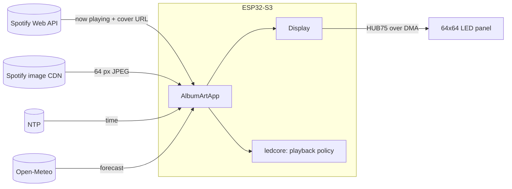

# Spotify Album-Art LED Display

An ESP32-S3 that shows the cover of whatever is playing on Spotify on a 64×64 RGB LED panel. Covers crossfade between tracks and the brightness dims at night. When nothing is playing, the panel rotates through a clock, and the local weather.

<!-- Add a photo or GIF of the panel here: docs/demo.jpg -->

## How it works



Every few seconds the firmware polls `currently-playing`. When the cover changes it downloads the smallest (64 px) JPEG, decodes it into an RGB565 frame buffer, and crossfades to it with gamma correction. After a pause or stop it keeps the cover for a minute, then fades out and starts rotating through the idle screens. The panel blanks after 20 minutes of idling.

| Idle screen | Source |
| --- | --- |
| Clock | NTP, in the configured time zone |
| Weather | [Open-Meteo](https://open-meteo.com/) (free, no API key) |

Screens with no data yet are skipped, so the clock always works even if the network is down. Data is only fetched while idle, one request per second at most.

## Hardware

| Part | Notes |
| --- | --- |
| Seengreat RGB Matrix HUB75 S3 | ESP32-S3-WROOM-1 (16 MB flash, 8 MB PSRAM), HUB75 connector, powers the panel |
| 64×64 P3 RGB LED panel | HUB75E, 1/32 scan |
| USB-C charger + two data-capable cables | one to the controller's USB-C port (programming), one to its Power port (panel) |

The HUB75 pin map is in [`include/config.h`](include/config.h) and comes from the [Seengreat wiki](https://seengreat.com/wiki/214). If you use different hardware, that file and the `[env:hub75-s3]` section of `platformio.ini` are the only things to change.

## Project layout

```
include/
  config.h              pins, timing, brightness, URLs (no secrets)
  secrets.h.example     template for your credentials
lib/ledcore/            hardware-independent logic, header-only, unit-tested
  Color.h               RGB565 unpack, blending, gamma LUT
  PlaybackPolicy.h      what to do after each poll; which account to show
  Rotation.h            carousel selection
  Weather.h             weather code -> icon
  Schedule.h            day/night window
  UrlEncode.h           form encoding
src/
  main.cpp              the only file that reads secrets.h
  AlbumArtApp.*         wires modules together; display state machine
  Display.*             HUB75 driver, text, crossfade
  SpotifyAuth.*         refresh-token flow, rotated token kept in flash
  SpotifyClient.*       now-playing request and parsing (one per account)
  CoverArt.*            download and JPEG decode
  ScreenCarousel.*      rotates the idle screens, skipping empty ones
  screens/              Screen interface; Clock and Weather screens
  PeriodicSource.*      base class: refresh schedule, retry, freshness
  WeatherService.*      Open-Meteo client
  HttpJson.*            HTTPS GET + filtered JSON parsing
  WifiManager.*         connect and recover
  TimeService.*         NTP / time zone
  Tls.*                 single place that sets the TLS policy
test/test_ledcore/      Unity tests, run on your computer
tools/spotify_login.py  one-time login that produces the refresh token
```

Decision logic lives in `lib/ledcore` with no Arduino dependencies, so it is tested on a desktop. Everything that touches hardware or the network is a small module with one job, and credentials are passed in as a plain struct rather than read from globals.

## Setup

**1. Create a Spotify app.** At [developer.spotify.com/dashboard](https://developer.spotify.com/dashboard) create an app, add the redirect URI `http://127.0.0.1:8888/callback`, and copy its Client ID. (In development mode the app owner needs Spotify Premium.)

**2. Get a refresh token.** No client secret is needed; the login uses PKCE.

```sh
python3 tools/spotify_login.py --client-id <your-client-id>
```

**3. Add your credentials.**

```sh
cp include/secrets.h.example include/secrets.h
# edit include/secrets.h: Wi-Fi name and password (2.4 GHz), client ID, refresh token
```

`include/secrets.h` is git-ignored.

**Optional: a second account.** Add the other person under **User Management** in your app's dashboard settings, run the login script again while they are logged in to Spotify (use a private window, or click "Not you?"), and paste their token into `SPOTIFY_REFRESH_TOKEN_2`. The panel shows whichever account is playing; if both are, it stays on the one already on screen.

**4. Build and flash.** Install [PlatformIO](https://platformio.org/), connect the controller's USB-C port, then:

```sh
pio run -e hub75-s3 -t upload
pio device monitor
```

## Configuration

Everything tunable is in [`include/config.h`](include/config.h): brightness and night hours, time zone, poll intervals, fade speed, idle timeouts, how long each idle screen is shown, and the weather location and units.

**Weather location:** set `kLatitude` / `kLongitude` (look up your city with Open-Meteo's [geocoding tool](https://open-meteo.com/en/docs/geocoding-api)).

## Testing

```sh
pio test -e native
```

CI (`.github/workflows/ci.yml`) runs the unit tests and a full firmware build on every push, using placeholder credentials.

## Security model

- **Secrets stay out of the repo.** Wi-Fi credentials and the refresh token live only in `include/secrets.h` (git-ignored). Only `secrets.h.example` is committed, and the build fails with a clear message if the real file is missing.
- **No client secret on the device.** The login uses OAuth PKCE; the firmware holds only a refresh token and a client ID.
- **Least privilege.** The token has two read-only scopes: `user-read-currently-playing` and `user-read-playback-state`.
- **Third-party requests carry no personal data.** The weather request contains only your configured coordinates and never involves your Spotify token.
- **No secrets in logs.** Tokens and response bodies are never printed.
- **Rotated tokens** are stored in the chip's flash (NVS). Anyone with physical access to the board can read the flash, so treat the device like the account it is logged into. To revoke access, remove the app at [spotify.com/account/apps](https://www.spotify.com/account/apps).
- **Known limitation: TLS certificates are not verified.** All HTTPS requests use `setInsecure()`, so a network attacker could impersonate Spotify. The exposure is limited to read-only playback state and a short-lived access token, but a production device should pin or bundle root certificates. The policy is isolated in [`src/Tls.cpp`](src/Tls.cpp) so it can be tightened in one place.
- **Leaked a secret?** Rotate the Wi-Fi password and revoke the Spotify app access, then generate a new refresh token. Deleting a file from git does not remove it from history.

## Troubleshooting

| Symptom | Likely cause |
| --- | --- |
| Compile error "Missing secrets.h" | Copy `include/secrets.h.example` to `include/secrets.h` |
| Panel stays black or shows noise | Check the ribbon cable and power; try `cfg.driver = HUB75_I2S_CFG::FM6126A` in `Display.cpp` |
| "Wi-Fi failed" on screen | The ESP32 only supports 2.4 GHz networks |
| `token refresh failed (HTTP 400)` in the log | Refresh token revoked or wrong; rerun the login script |
| Shows the clock while music plays | Spotify only reports playback for the accounts whose tokens are in `secrets.h` |
| Weather screen never appears | Check the serial log for `refresh failed`; the screen is skipped until a fetch succeeds |

## Roadmap

Calendar, sports and fantasy football screens; verified TLS; over-the-air updates.

## License

[MIT](LICENSE)
